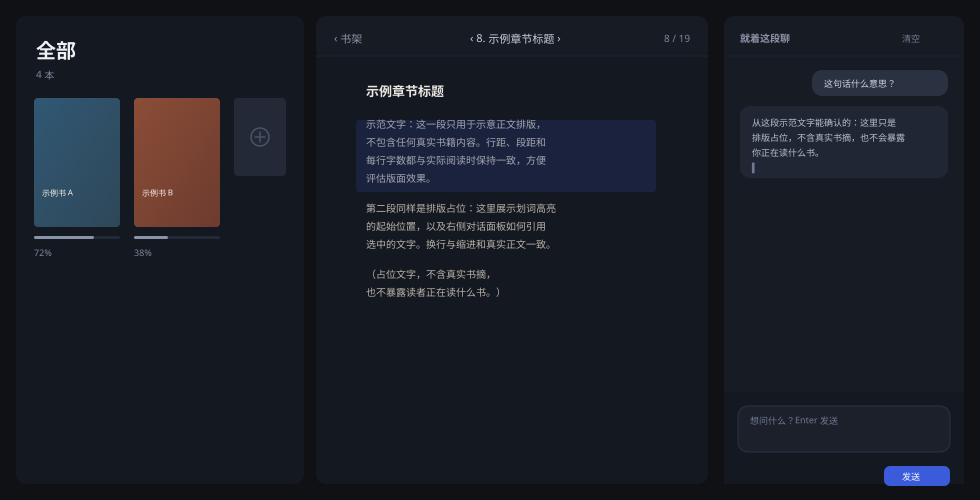

<h1 align="center">Shared Reading</h1>

<p align="center"><strong>Read inside DSH: the book on the left, your highlight on the right, the conversation next to it.</strong></p>

<p align="center">
  <a href="./README.md"></a>
  <a href="./README.en.md"></a>
</p>

<p align="center">
  <a href="./LICENSE"></a>
  <a href="https://github.com/AstralHorizon4/dsh-shared-reading"></a>
</p>

**Shared Reading** (`dsh-shared-reading`) is a reading plugin for DSH: import EPUB / TXT / Markdown / HTML, read them page by page, highlight one sentence and ask about it. Answers stream from a real agent, and the discussion plus your progress stay on your machine.



| Capability | What you give it | What you get |
| --- | --- | --- |
| **Shelf** | EPUB, TXT, Markdown, HTML | A cover grid with progress and chapter counts, most recently read first |
| **Reading** | An imported book | Paginated to the viewport, no scrolling; page turning, chapter jumps, type size |
| **Ask about a highlight** | One sentence from the text | A streamed answer in that book's own agent session |
| **Local data** | — | Plain files under `~/.dsh/shared-reading/`, copy the folder and it moves |

> **Local first.** Books, progress, and conversations are local files; the plugin makes no network requests of its own.
>
> **Spoiler safe.** The tools that read the source refuse chapters you have not reached yet.

## Supported formats

| Format | How it is handled |
| --- | --- |
| EPUB (text) | Text and cover are extracted; chapters follow spine documents |
| TXT / Markdown / HTML | Split on headings; the cover is a colour block generated from the title |
| PDF / AZW3 / KF8 | Not supported, and it says why (highlighting needs reflowable text) |

## Installation

```bash
dsh plugin --profile <your profile> add "github:AstralHorizon4/dsh-shared-reading"
```

Restart the app and a book icon appears in the sidebar. The plugin is plain JS with no build step; for local development, `add` the directory itself (changes take effect on the next load).

Data lives in `<DSH_HOME>/shared-reading/` (default `~/.dsh/shared-reading/`).

## Using it

1. Refresh DSH and a book icon appears in the left sidebar (below Plugins and Schedules). Open it and the reading panel takes over the main area.
2. Pick a file under **Import book**. EPUBs bring their cover along, so the shelf shows the real jacket; TXT/MD/HTML get a colour-block cover derived from the title. Importing the same file twice does not create a duplicate: the plugin fingerprints each book from its chapter titles plus body text (SHA-256) and jumps to the existing one instead ("already on the shelf"). The same book as EPUB and as TXT splits differently, so it counts as two books.
3. The shelf lays covers out in a 2:3 grid with progress and chapter count underneath, most recently read first — the current book is always at the front. Hover a cover for the `✕` delete button; `Continue reading …` returns to the exact page you left.
4. Stop where you want, then drag across a sentence with the mouse — a quoted-selection bar appears at the bottom right. Type your question and press Enter; the answer streams in character by character, and the question, quote, and answer are stored with that book.

The divider between the text and the conversation is draggable: 300–640px wide (the text keeps at least 320px). Double-click it to reset, or focus it and nudge with the arrow keys; the width is remembered.

Reading is **paginated, never scrolled**: the text is laid out into pages sized to the current viewport, and each page is its own surface — page turning swaps pages with a 150 ms fade. `←` / `→` (or `PageUp` / `PageDown` / Space) turn pages; turning right on the last page of a chapter moves into the next chapter. The arrows in the top bar do the same, and the chapter dropdown in the middle jumps between chapters. `A− / A+` change the type size while keeping your position.

Progress is measured in **character offset** (the page within a chapter is folded into a chapter-relative ratio), so the percentage moves continuously with one decimal instead of jumping a chapter at a time. Pages and progress are written to `progress/<id>.json`, so reopening returns you near the same page. Typing in the input box, or holding `⌘/Ctrl/Alt`, does not turn pages.

## How it connects to the agent

The chat header has **Clear** on the right and only the current model name on the left — the panel has exactly one way to talk: **into that book's dedicated agent session**.

- The first question creates a session through `POST /__shared-reading/session` (`sessionController.create()` on the host side), and the id is stored locally (`shared-reading:session:<bookId>`). Every later question about that book goes to the same session.
- It inherits no context from existing conversations, so work context never leaks into reading questions, and reading questions never pollute work sessions.
- Answers come from a real agent (full tools plus multi-turn memory), sent with `ISession.prompt()`; the panel mirrors the stream from `assistant/live-chunk`. If the mirror is unavailable, the bubble offers "Open conversation" instead.
- **Clear** wipes the panel's conversation log (`chat/<id>.jsonl`) and drops the session binding; the next question opens a fresh session. The old session is not deleted from the sidebar.
- Assistant answers render as Markdown: headings, bold/italic, inline code, code blocks, lists, quotes, rules, `[text](links)`, and bare links (opened in a new window). User messages stay verbatim.

The books you have read, and your position, are also passed in as a small system prompt, so the model can call `reading_shelf` / `read_chapter` / `reading_search` / `reading_selection` on its own to fetch the source — that part is always in effect.

**Spoiler safe**: `read_chapter` and `reading_search` refuse chapters beyond `maxChapterIndex`. Flipping back to re-read never shrinks that boundary — position and read-range are two separate numbers.

## Boundaries

- No PDF (highlighting needs reflowable text); AZW3 / KF8 are rejected with an explanation.
- EPUB contributes text only — no layout, images, or footnote jumps are rebuilt; chapters follow spine documents.
- A highlight anchors on "chapter number + quoted text", not EPUB CFI. Changing type size never shifts it, but if a sentence appears twice in one book, the first occurrence wins.
- Search is plain substring matching (query split into words from your own phrasing), not vector search.

## Data

```text
~/.dsh/shared-reading/           # macOS / Linux; %USERPROFILE%\.dsh\shared-reading\ on Windows
  state.json                     currently open book
  books/<id>/meta.json           title, author, format, chapter count, word count
  books/<id>/sections.json       flattened chapter text
  progress/<id>.json             { chapterIndex (viewing), maxChapterIndex (read), percent }
  chat/<id>.jsonl                conversation log (append-only)
```

Copy the folder and you can continue reading on another machine; every write is tmp + rename and the logs are append-only. The plugin itself makes no network calls — the highlight and the chapter window are handed to DSH's model routing locally, and requests go out through the provider you configured in DSH.

## Project structure

```text
index.js             host entry: wires store / library / tools / prompt / routes
host/store.js        data root, atomic writes, JSONL appends
host/formats.js      ZIP (EPUB) parsing, HTML/TXT/Markdown chaptering, encoding fallback
host/library.js      shelf, progress, conversations
host/model.js        default model routing + streamed text
host/guidance.js     companion persona and context block
host/routes.js       the /__shared-reading HTTP surface (SSE included)
host/tools.js        the four tools the model can see
client.js            sidebar icon + full-page reading panel (single file, React from the platform module table)
scripts/selftest.mjs self-test without DSH: builds an EPUB, imports, exercises routes and tools
```

## Development and self-test

```bash
node scripts/selftest.mjs
```

The script builds a two-chapter EPUB plus a TXT, a Markdown, and an HTML file on the spot, then exercises parsing / progress / conversations / routes / all four tools. No model is needed (the streaming `/ask` path is verified with a fake LLM).

Changing host code requires **restarting the app** (ESM caches by path); changes to `client.js` only need a page refresh.

## FAQ

**Why no PDF?**
Highlights have to anchor to reflowable text. PDF is fixed layout, and after reflow you cannot reliably locate the original sentence, so it is rejected outright instead.

**Why pages instead of scrolling?**
Each page is its own surface, and turning is a page swap plus a fade. Horizontal sliding makes the seam between two pages look like dragging one long canvas, which feels wrong for both reading and highlighting.

**Does it spoil the ending?**
`read_chapter` and `reading_search` refuse chapters beyond `maxChapterIndex`, and flipping back never shrinks the read range — position and read boundary are separate numbers.

**How do I move to another machine?**
Copy `~/.dsh/shared-reading/` across; the shelf, progress, and conversations come with it.

**Is my book uploaded anywhere?**
The plugin makes no network requests of its own; conversation goes through the agent session in your local DSH, and model requests are sent by DSH to the provider you configured.

## License

[MIT](./LICENSE) © AstralHorizon4

---

**Chinese is the default language**; this English version is a maintained mirror: [简体中文](./README.md).
