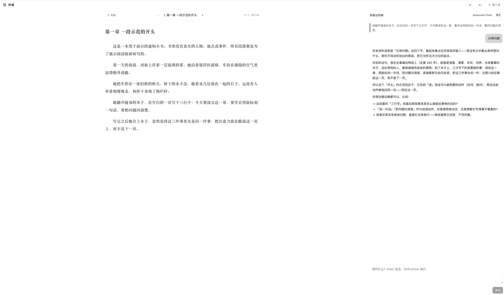

<h1 align="center">共读</h1>

<p align="center"><strong>在 DSH 里读书：左边正文，右边就着你划出的那句话聊。</strong></p>

<p align="center">
  <a href="./README.md"></a>
  <a href="./README.en.md"></a>
</p>

<p align="center">
  <a href="./LICENSE"></a>
  <a href="https://github.com/AstralHorizon4/dsh-shared-reading"></a>
</p>

**共读**（`dsh-shared-reading`）是 DSH 的读书插件：导入 EPUB / TXT / Markdown / HTML，分页阅读，划一句话就问；回答由真 agent 流式产出，讨论与进度全部留在本地。




| 能力 | 你给它什么 | 它给你什么 |
| --- | --- | --- |
| **书架** | EPUB、TXT、Markdown、HTML | 按封面铺格的网格，带进度与章数，最近在读优先 |
| **阅读** | 一本导入的书 | 按视口宽度分页，不滚屏；翻页、跳章、调字号 |
| **划词提问** | 正文里的一句话 | 这本书专属 agent 会话里的流式回答 |
| **本地数据** | —— | `~/.dsh/shared-reading/` 下的纯文件，整份拷走即可迁移 |

> **本地优先。** 书、进度、对话都是本地文件；插件自身不发起网络请求。
>
> **防剧透。** 读原文的工具按「已读到第几章」拒绝未读章节。

## 支持的格式

| 格式 | 处理方式 |
| --- | --- |
| EPUB（文字版） | 取文字与封面，章节以 spine 文档为界 |
| TXT / Markdown / HTML | 按标题切章，用书名生成色块封面 |
| PDF / AZW3 / KF8 | 不支持，会说明原因（划词需要可重排的正文） |

## 安装

```bash
dsh plugin --profile <你的 profile> add "github:AstralHorizon4/dsh-shared-reading"
```

装完重启应用，侧栏会出现书本图标。插件是纯 JS，没有构建步骤；本地开发时直接 `add` 这个目录即可（目录里的改动下次加载生效）。

数据在 `<DSH_HOME>/shared-reading/`（默认 `~/.dsh/shared-reading/`）。

## 用起来

1. 刷新一下 DSH 页面，左侧边栏会多一个书本图标（在「插件」「定时」下面）；点开就是占满主区的「共读」页。
2. 「导入书」选文件。EPUB 会连封面一起读进来，书架上是真实的书封；TXT/MD/HTML 用按书名生成的色块封面。同一份文件再导入一次不会多出一条：按「章节标题 + 正文」算 SHA-256 指纹，命中已有的那本就切过去（提示「已经在书架上了」）。同一本书的 EPUB 和 TXT 切章方式不同，指纹也不同，仍算两本。

   想先看效果，可以直接导入仓库里的 [`demo/demo-book.epub`](demo/demo-book.epub)：一本纯虚构的三章小书，封面和正文都由本项目生成，不涉及任何真实书籍。
3. 书架按封面铺格子（2:3），下面一行是进度和章数，顺序是「最近在读」优先 —— 正在读的那本排最前。悬停封面右上角出现 `✕` 删除；`继续读《…》` 回到刚才那一页。
4. 翻到想停的地方，用鼠标划一句话 —— 右下角出现「已选中」的引用条。写一句想问的，Enter 发送，回答按字流式出现；这次的提问、引文和回答会存进这本书的对话里，换书再切回来还在。

正文和右侧对话之间的分隔线可以拖动：范围 300–640px（正文至少留 320px），双击恢复默认宽度，聚焦后用方向键微调，宽度会记住。

阅读是**分页**的，不滚屏：正文按当前视口宽度排成若干页，一页就是一张独立的页面；翻页是直接换页 + 150ms 淡入。`←` / `→`（或 `PageUp` / `PageDown` / 空格）翻页，翻到本章最后一页再往右会进入下一章；顶栏的左右箭头同样是翻页，中间的章节下拉用来跳章。`A− / A+` 调字号并保持当前阅读位置。

进度按**字符位置**算（章内页码折算成章内比例），所以百分比是连续变化的（保留一位小数），不会一章一跳；页码和进度都写进 `progress/<id>.json`，下次打开回到同一页附近。输入框里打字、或按 `⌘/Ctrl/Alt` 组合键时不会翻页。

## 它怎么接上 agent 的

聊天区右上角是「清空」，左边只显示当前模型名 —— 面板只有一种对话方式：**发进这本书专属的 agent 会话**。

- 第一次提问时用 `POST /__shared-reading/session`（Host 侧 `sessionController.create()`）现开一个会话，id 存在本地（`shared-reading:session:<bookId>`），之后这本书的问题都进这个会话。
- 它不从任何已有对话继承上下文，所以不会把工作会话的上下文带进读书问题；反过来也不会污染工作会话。
- 回答由真 agent 产生（完整工具 + 多轮记忆），用 `ISession.prompt()` 发进去，面板按 `assistant/live-chunk` 镜像流式输出；镜像拿不到时，气泡里给「打开对话」。
- 「清空」会清掉面板里的对话记录（`chat/<bookId>.jsonl`）、取消当前的会话绑定，下一个问题会再开一个新会话；侧栏里那个旧会话不会被删除。
- 助手回答按 Markdown 渲染：标题、加粗/斜体、行内代码、代码块、列表、引用、分隔线、`[文字](链接)` 和裸链接（新窗口打开）；用户消息仍是原文。

另外，读过的书和位置本身也会作为一小段 system prompt 出现在会话里，模型可以主动用 `reading_shelf` / `read_chapter` / `reading_search` / `reading_selection` 取原文 —— 这条始终有效。

**防剧透**：`read_chapter` 与 `reading_search` 按「已读到第几章」（`maxChapterIndex`）拒绝未读章节。往回翻重读不会缩小这个边界 —— 位置和已读范围是两个数。

## 边界

- 不做 PDF（划词需要可重排的正文）；AZW3 / KF8 会明确拒绝并说明原因。
- EPUB 只取文字，不还原排版、图片、脚注跳转；转换后的章节以 spine 文档为界。
- 划线锚点是「章号 + 原文引用」，不是 EPUB CFI。换字号不会漂，但同一句在书里出现两次时，定位以第一次为准。
- 检索是纯子串匹配（按读者的话拆词），不是向量检索。

## 数据

```text
~/.dsh/shared-reading/           # macOS / Linux；Windows 是 %USERPROFILE%\.dsh\shared-reading\
  state.json                     当前打开的书
  books/<id>/meta.json           标题、作者、格式、章数、字数
  books/<id>/sections.json       摊平后的章节正文
  progress/<id>.json             { chapterIndex（在看）, maxChapterIndex（已读到）, percent }
  chat/<id>.jsonl                讨论记录（只追加）
```

整份拷走就能换机器接着读；所有写入都是 tmp + rename，日志只追加。插件本身不联网，划词与章节窗口只在本地交给 DSH 的模型路由，请求按你在 DSH 里配置的 provider 发出。

## 项目结构

```text
index.js             Host 入口：装配 store / library / tools / prompt / routes
host/store.js       数据根、原子写、JSONL 追加
host/formats.js     ZIP(EPUB) 解析、HTML/TXT/Markdown 切章、编码回退
host/library.js     书架、进度、对话
host/model.js       默认模型路由 + 流式取文本
host/guidance.js    伴读人格与上下文块
host/routes.js      /__shared-reading 的 HTTP 面（含 SSE）
host/tools.js       模型可见的四个工具
client.js           侧栏图标 + 整页阅读面板（单文件，React 由平台模块表提供）
scripts/selftest.mjs  无 DSH 的自测：造 EPUB、导入、跑路由与工具
```

## 开发与自测

```bash
node scripts/selftest.mjs
```

会现场造一本两章的 EPUB、一个 TXT、一个 Markdown、一个 HTML，跑解析 / 进度 / 对话 / 路由 / 四个工具；不需要模型（`/ask` 的流式路径用假 llm 验证）。

改完 Host 代码要**重启应用**才生效（ESM 按路径缓存）；只改 `client.js` 刷新页面即可。

## 常见问题

**为什么不做 PDF？**
划词要锚在可重排的正文上。PDF 是固定版式，重排后无法稳定定位到原句，所以宁可明确拒绝。

**为什么是分页而不是滚动？**
一页是一张独立的页面，翻页是换页 + 淡入。横向滑动会让相邻两页的接缝看起来像在拖一条长画布，阅读和划词都会别扭。

**会不会剧透？**
`read_chapter` 和 `reading_search` 按 `maxChapterIndex` 拒绝未读章节；往回翻重读不会缩小已读范围，位置和已读边界是两个数。

**换电脑怎么办？**
把 `~/.dsh/shared-reading/` 整份拷过去即可，书架、进度和讨论记录都跟着走。

**书的内容会被上传吗？**
插件自身不发网络请求；对话走你本地 DSH 里的 agent 会话，模型请求由 DSH 按你配置的 provider 发出。

## License

[MIT](./LICENSE) © AstralHorizon4

---

**中文是默认语言**，英文版作为镜像维护：[English](./README.en.md)。
